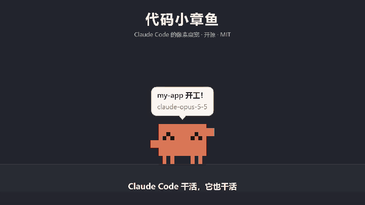

# Code Octopus

[简体中文](README.md) · **English**

A pixel-art desktop pet for Claude Code (Windows).



> **Unofficial project**: this is a community fan project. It is not affiliated with, endorsed by, or sponsored by Anthropic. Claude and Claude Code are trademarks of Anthropic.

A little pixel octopus lives on your desktop and follows along with Claude Code:

- **It works when Claude works**: dots float over its head while Claude thinks, it types on a laptop while Claude edits code, a tiny terminal pops up next to it when a command runs, it holds a magnifying glass while Claude reads code, and an antenna goes up when Claude searches the web
- **It comes to find you when you're needed**: on a permission request, a question from Claude's question tool, or a plan waiting for your OK, it hops to the middle of the screen holding a blinking "!" or "?" sign and keeps bouncing there. Its glowing bubble shows the command to approve or the question to answer. Click it to say "got it"
- **Claude-style bubbles and captions**: off-white rounded bubbles. While it works, the bubble has the spinning ✻ and a timer like Claude Code's status line, titled with the current todo. Captions type out your message, the running command and Claude's summary when it's done. Settings has three levels: Alerts only / Brief / Full
- **It celebrates and it sulks**: confetti when tests pass or a task finishes, tears when tests fail. When Claude commits, it pumps a fist and a green check pops up next to it; when a push goes through, it waves a little rocket off (only commits and pushes that actually succeeded count, not "nothing to commit" or a rejected push)
- **Subagents = little helpers**: when Claude sends out subagents, a few mini octopuses pop up and type alongside it
- **More sessions = more octopuses**: every Claude Code session you have open gets its own octopus in its own color. Hover one to see which project it belongs to
- **Approve right on the pet** (turn it on in settings): when Claude asks for permission and you aren't looking at that session's window, the bubble under the sign shows the full command plus Allow / Deny / Open terminal, and your click goes back to Claude Code as the decision. The buttons only take clicks after they've been still for 0.7 seconds, so the pet can't hop under your cursor and catch a click meant for something else. A command too long to show in full gets no Allow button; read it in the terminal. If you switch to that window, answer in the terminal, the session's window can't be found, or 3 minutes pass, Claude Code asks you in the terminal as usual
- **Progress card**: click an octopus that is working (or just finished) to see this turn's todo list (✓ done, ▸ in progress, ○ not started), the number of tool calls, the files it changed and the latest command
- **Click to jump back to the session**: when it's holding up a sign, click it and the terminal, editor or Claude app window running that session comes to the front. The right-click menu and the settings panel have "Jump to" too. It works by looking up the process behind the hook request's connection and walking up its parents until one has a window
- **Context fullness**: it reads context usage from the session transcript. At half full it starts to plump up, at 80% it's round as a ball (it also walks slowly and reminds you to /compact), and it slims back down after compaction
- **Long task alerts**: if a turn ran for over 2 minutes and you're looking at another window when it finishes, the octopus hops to the middle of the screen with a green ✓, its bubble showing how long it took and Claude's summary. An 8-bit chime is optional
- **Daily summary**: it keeps local stats on how much you and Claude did each day (messages, tool calls, tests, files changed, busy time, cost, hour-by-hour rhythm, plus what got committed and how many pushes). Every evening at 21:30 it brings you a pixel-art report card you can copy or save. Below the card are the last 30 days (busy time / tool calls / cost, with totals, active days, average and best day); click a bar to open that day's report
- **Windows are terrain**: it strolls along your windows' title bars, jumps up and hops over to other windows. Drag away or minimize the window it's standing on and it falls and lands on its bottom
- **Window collisions** (can be turned off): windows are solid. Walking into one makes it turn around or climb over, jumping from below bumps its head, and dragging a window into it pushes it away. Windows hidden behind a maximized window don't count
- **Play with it**: pat its head and it squints and blushes, poke its belly and it giggles, take its hand to shake hands, tickle its feet and it kicks. Keep poking and it stomps off in a huff. Press and hold to squish it, let go and it bounces away, double-click to make it spin, rub the mouse back and forth over it and it gets shy, and pick it up to throw it
- **Feather toy**: right-click "Play with me" and a feather dangles under your cursor. The octopuses chase it, pounce and swat at it, then sit down to catch their breath
- **Octopus Arcade**: "Mini games…" in the right-click or tray menu. Seven games, each with rules, a countdown, pause (switching to another window pauses automatically) and a results screen; your best scores are saved, and when you break a record the octopus on your desktop runs over to celebrate. Each game has an achievement (reach iteration 8 in Bug Hunt, 300 m in Window Hop, 20 right in a row in Allow or Deny, survive 15 waves in the tower defense, 40 WPM in Type the Code, 30 frames in Call Stack, 65 fixes in one round of Hotfix). The rules page shows the goal and your progress, and earning one gives you an outfit that the desktop octopus puts on right away if that spot is free. The rules page also has the **Daily challenge** (press T): a round fixed by the date, so everyone gets the same one that day (what falls, how the windows are laid out, which questions come up, what each wave brings, which lines to type, which functions to stack, what pops up in which terminal). Your best for the day is kept separately and also counts toward your overall best. The top right of the menu shows how many days in a row you've played it (with a nudge if you haven't played yet today), and 7 days in a row earns an achievement. The octopus in the games is yours, same color and same outfit
  - **Bug Hunt**: bugs fall out of the code and you run left and right to catch them. Catching in a row multiplies your score. A bug hitting the desk or catching a red `rm -rf` costs a heart, coffee gives one back (or points when your hearts are full). Every 20 seconds a new iteration starts and everything gets faster
  - **Window Hop**: jump your way up a stack of small windows. Blue windows are being dragged around, red ones minimize after one step, and yellow sticky notes are springs. Leave one side of the screen and you come back on the other. The higher you go, the more the sky turns from day to starry night
  - **Allow or Deny**: Claude asks you to approve commands one by one. Allow the safe ones, deny the dangerous ones (`rm -rf ~`, `curl … | sh`, sending secrets somewhere, force-pushing main…). It speeds up, three mistakes end the game, and the results tell you what was wrong with each one you missed. The commands are only text on screen and never run
  - **Guard the Main** (tower defense): bugs crawl along a git branch toward `main`, and you place octopuses beside it as towers: Tests (single target, fast), Lint (sticky slow that splashes onto neighbors), Review (area damage) and Types (long range, heavy hits, slow). All of them upgrade to level 3 and can be sold. Enemies are plain bugs, fast race conditions and tough memory leaks, with legacy code every 5 waves. Fixing bugs earns tokens, and the game ends when `main`'s stability runs out; there's no last wave. You can start the next wave early for extra tokens and switch to 2× speed
  - **Type the Code**: 60 seconds of typing code shown on screen, line by line (`git status`, `const sum = a + b;`, SQL…). Correct characters turn green; a wrong key keeps you where you are until you type the right one. A line without mistakes earns 10 bonus points, lines get longer as you go, and the results show WPM and accuracy. Use an English keyboard layout; if a Chinese or Japanese input method is on, the game reminds you to switch
  - **Call Stack**: a one-button game. A new stack frame (`fetchUser()`, `db.query()`…) slides back and forth above the stack; press Space or click to drop it. Whatever hangs over the edge is cut off, so frames get narrower. Land one exactly and nothing is cut, and a few in a row make it grow back a little; miss completely and it's over. Frames slide faster as you climb, a debugger-style panel on the left lists the current call stack, past 40 it's all `recurse()`, and at 50 you hit Stack Overflow
  - **Hotfix**: a mouse game. Bugs keep popping up in nine terminal windows; click one (or press 1-9) to fix it, and fixing them in a row scores more. Red production incidents are worth more but cost a heart if they get away, and clicking a green feature costs a heart too. 60 seconds, or until your three hearts are gone
- **Pomodoro and notes**: start a pomodoro from the right-click menu (15 / 25 / 45 minutes). While you focus it types on its laptop next to you, and when time's up it brings a tomato sign to tell you to take a break. "Jot something down" saves a one-line note, optionally with a reminder time, and when the time comes it runs over holding the note
- **It dances to your music**: while your computer is playing sound, idle octopuses bounce to the beat and working ones nod along (it only reads the system output level and never records anything)
- **It follows the time of day**: says good morning, reminds you about lunch, carries a little lantern at night, and if you're still at the computer after midnight, suggests you get some sleep
- **It keeps itself busy**: when idle it walks around, sits, stretches, looks around and dances. Two that meet say hi. When sleepy it yawns first, then dozes off
- **Octopuses play together**: when two or more are idle on the same platform, every so often they toss a ball, stack up into a tower or walk in a line. If there's only one, right-click "Invite a friend to play" and a differently dressed octopus comes over for a round, then leaves
- **Achievements and outfits**: 20 achievements (first passing test, a 7-day streak, 500 tool calls in a day, still working in the small hours…, plus one for each game in the arcade and one for a 7-day daily challenge streak). Each unlocks an outfit (crown, top hat, sunglasses, bow tie, scarf…; the games give a bug hair clip, flight goggles, a security badge, a hard hat, a green visor, a monocle, a gold medal and a fire helmet). It's put on automatically if that spot is free, and you can change it in the Wardrobe in settings. On holidays, by your computer's date, it dresses up on its own (New Year, Lunar New Year, Valentine's Day, April Fools', Children's Day, Dragon Boat Festival, Mid-Autumn Festival, 1024 Programmers' Day, Halloween, Christmas). With nothing on its head it wears something seasonal (spring flowers, a summer straw hat, an autumn maple leaf, winter earmuffs), and now and then petals, fireflies, leaves or snowflakes drift down
- **Feed it files**: drag a file from Explorer onto it and it gulps it down, moving it into an "Octopus Belly" folder sorted by month. Files are only moved, never deleted; right-click "Spit out" puts them back. It won't eat folders or system files. When 25 or more files pile up in your Downloads folder, it comes to tell you it's hungry, at most once a day
- **Multiple monitors**: one overlay per screen. Pets can walk, be thrown or be dragged to the next screen. A new session's octopus appears on the screen where that session's window is, and "Call them to the center" brings them to the screen you're looking at
- **Onboarding**: the first time you open it, the octopus drops into the middle of the screen, introduces itself, shows off a few tricks, and finally walks you through connecting Claude Code (you can replay it from the settings panel)
- **Languages**: follows your system language. Simplified Chinese, Traditional Chinese, English and Japanese are supported, and you can switch by hand in settings
- If you're away for 5 minutes they fall asleep, and they wave when you come back. They hide while a video or game is full screen; if Claude needs your approval, asks a question, has a plan ready or finishes a long task during that time, you get a system notification instead, and clicking it takes you to that session (can be turned off in settings). With "Approve from the pet" on, permission requests hidden by a full-screen app go straight to the terminal

## Install

Download `Code-Octopus-Setup-<version>.exe` from the GitHub Releases page and run it. The installer isn't code-signed, so the first run shows "Windows protected your PC": click "More info", then "Run anyway". After installing, open settings from the tray icon and click "Connect to Claude Code".

## Run from source

```bash
npm install
```

```bash
npm start
```

Or double-click `启动桌宠.cmd`.

> If Electron can't be found after `npm install`, run `node node_modules/electron/install.js` once (recent npm versions don't run install scripts by default).

### Build an installer

```bash
npm run dist
```

This creates `Code-Octopus-Setup-<version>.exe` in `dist/` (an NSIS installer that lets you pick the install folder, installs for the current user and doesn't need admin rights). `npm run pack` only builds the portable `dist/win-unpacked/`. The icon is generated by `scripts/make-icon.js` from the tray icon's pixel grid. The installer isn't code-signed, so other people will see SmartScreen's "Unknown publisher" warning the first time.

The installed version and the development version share one data folder (`%APPDATA%\claude-pet`, the name from before the rename, kept so existing users don't lose their settings and stats), so settings, stats and achievements carry over. They also share the single-instance lock, so the two never run at the same time.

**Auto update**: the installed version checks GitHub Releases for new versions, downloads them in the background and installs on quit. The repository it checks is set in `src/release.json`; it's currently `xiaobai1556/code-octopus` (if it's still the placeholder `YOUR_GITHUB_NAME`, builds won't check for updates). To publish a release:

1. Bump `version` in `package.json` (say, to `0.4.0`), commit and push
2. Push a tag with the same version. The "Release" GitHub Actions workflow runs the tests on Windows, builds the installer and uploads it with `latest.yml` to a draft on the Releases page (it fails right away if the tag and the version don't match):

   ```bash
   git tag v0.4.0
   ```

   ```bash
   git push origin v0.4.0
   ```

3. Open the draft on the Releases page, write a few lines about what changed and click "Publish release". Auto update can't see drafts; people on older versions get the update once it's published

To just check that packaging works, pick "Release" → "Run workflow" on the Actions page. It only builds, puts the installer in that run's Artifacts and leaves Releases alone. You can also publish by hand from your own machine with `electron-builder --config electron-builder.config.js --win --publish always` (needs `GH_TOKEN`).

Once it's running there's an octopus icon in the tray at the bottom right: **left-click** opens the settings panel and **right-click** opens the quick menu. While the pet is running, `npm run settings` also opens the settings panel and `npm run arcade` opens the Octopus Arcade.

## Connect Claude Code

There are two ways, each with a one-click switch under "Connect to Claude Code" in the settings panel. Having both on is fine; duplicate events are dropped. Changes apply to **newly started** Claude Code sessions.

**Claude Code plugin (recommended)**: managed by Claude Code's own plugin system, so you can disable or remove it any time with `/plugin`. Clicking "Install" in the settings panel is the same as:

```bash
claude plugin marketplace add <this project's folder, or your-name/code-octopus on GitHub>
```

```bash
claude plugin install code-octopus@code-octopus
```

**Write to settings.json directly**: doesn't depend on the plugin system. It adds a set of hooks to `~/.claude/settings.json` (backing the file up to `settings.json.bak-claude-pet` first), and disconnecting removes only the parts the pet added.

Both send exactly the same hooks: curl POSTs Claude Code's events to `http://127.0.0.1:23333/event`, asynchronously (`async: true`), so Claude isn't slowed down. When the pet isn't running, curl can't connect and fails silently.

Permission requests (`PermissionRequest`) are the one exception: that's a synchronous `http` hook to `/permission`. Claude Code ignores decisions returned by async hooks, so this is the only way "Approve from the pet" can work. With the feature off, the pet answers right away with an empty response; with the pet not running, the connection fails. Either way Claude Code asks you in the terminal as usual. If you're upgrading from an older version, the settings panel shows "Update": for the plugin, click "Update" (plugin version 0.3.0; from 0.3.0 the plugin is called `code-octopus`, and if you still have the old `claude-pet` plugin, one click on "Update" swaps it for the new one); for settings.json, click "Update" to reconnect. The plugin's `plugin/hooks/hooks.json` is generated from `src/hooks.js` by `npm run build:plugin`.

## Uninstall

First remove the plugin and disconnect settings.json under "Connect to Claude Code" in the settings panel, then uninstall from Windows Settings → Apps. The uninstaller doesn't touch `~/.claude`: if you skip disconnecting, every Claude Code event afterwards runs a curl that goes nowhere (it can't connect, and Claude Code works fine; it's just wasted).

If you already uninstalled, remove the plugin by hand:

```bash
claude plugin uninstall code-octopus@code-octopus --scope user
```

```bash
claude plugin marketplace remove code-octopus
```

Then open `~/.claude/settings.json` and delete every entry under `hooks` that mentions `claude-pet`. The `settings.json.bak-claude-pet` next to it is how the file looked right before the last connect or disconnect; settings you changed after that aren't in it, so don't just copy it over. Settings, stats and achievements live in `%APPDATA%\claude-pet`; delete the whole folder if you don't want them.

## Settings panel

- **Octopuses**: which project each one belongs to, what it's doing and how much context it has used. Jump back to its session, put it to sleep or wake it up
- **Play**: dancing to music, following the time of day, pomodoro length, global shortcuts (when on, Ctrl+Alt+O calls the octopuses to the middle of the screen you're looking at from anywhere, and Ctrl+Alt+G opens the Octopus Arcade; you're told if another program already has the shortcut)
- **Appearance**: size, main color, speech bubbles (Alerts only / Brief / Full), window collisions, context window (auto / 200K / 1M), sounds, system notifications in full screen, language
- **Wardrobe**: one item each for head, face and neck. Locked items show how to unlock them. The holiday row shows what it wears for each holiday this year, plus a switch for holiday outfits
- **Achievements**: progress and unlock dates for all 20
- **Feeding**: on/off, where the "belly" folder is, the messy-Downloads reminder, and spitting out the last meal
- **Updates**: auto update on/off and check for updates (skipped for the development version and when no release repository is set)
- **Today's summary**: opens the report card, and you can page back through earlier days
- **Mini games**: opens the Octopus Arcade
- **Connect to Claude Code**: status and switches for the two methods above (with one-click update when there's a new version), and "Approve from the pet"
- **Recent events**: the latest Claude Code events received, and whether each came from the plugin or settings.json, handy for checking the connection
- Play the demo of every animation, call them to the middle of the screen, replay the onboarding, start at login, quit

## Languages

Every piece of UI text and every line the octopus says lives in `src/i18n.js`. The language is picked from the system (`app.getPreferredSystemLanguages()`), falling back to English for unsupported languages. To add a language, add an entry to both `NAMES` and `STRINGS`, then add its system language prefix in `detect()`.

## Debugging

- `npm test`: runs the unit tests in `test/` (Node's built-in `node:test`, nothing else to install, no Electron needed). They cover event parsing and test-result detection, adding and removing hooks, terrain, holidays and outfits, daily stats, context reading, feeding files, whether every language has every string, whether the plugin's `hooks.json` is in sync with `src/hooks.js`, and every mini game: in Node, with a fake painter, bots play a few rounds doing nothing or mashing keys, clicking and typing at random. Nothing may throw, no drawing coordinate may be NaN, the results must be sane numbers, and the daily challenge must serve the same content however you play
- `npm run demo`: plays every reaction once after startup
- `curl http://127.0.0.1:23333/state`: shows every screen (`screens`: work area, scaling, openings to neighboring screens, click regions, terrain), every pet's state and bubble (which screen, what it's wearing), each session's window and context usage (`sessions`), unlocked achievements, update status, recent events, the number of dropped duplicate events, mouse button logs (`captureLog`), follow stats for the last few window drags (`drags` is the main process scan interval, `screens[].renderer.stats.rides` is the interval at which pets receive positions and redraw), and errors: `errors` from the main process (timer loops, overlay crashes; a crashed overlay reloads itself) and `screens[].renderer.stats.frameErrors` / `lastFrameError` from the overlay's main loop (a frame that throws is skipped and the animation carries on)
- Environment variable `CLAUDE_PET_SPLIT=1`: pretends the main screen is two screens side by side, so you can try moving between screens without a second monitor
- If the port is taken, set a different one with the environment variable `CLAUDE_PET_PORT`. This only works for the settings.json method (reconnect after changing it); the plugin always uses 23333

## Lessons learned

- **Don't use `setIgnoreMouseEvents(true, { forward: true })`**: it installs a global low-level mouse hook in the main process, and with a high polling rate mouse it starves the main process's timers, so the pet stutters while you drag windows. The main process now reads the cursor position every 16 ms instead.
- **Don't subscribe to `EVENT_OBJECT_LOCATIONCHANGE`**: it fires on every mouse pointer move too. Now it only subscribes to "start / end of window drag", and during a drag it turns on a 1 ms system timer and scans window positions every 4 ms.
- **On high refresh rate screens `requestAnimationFrame` runs at 144/240 Hz**: a transparent window commits the whole screen on every frame, so it only redraws when something actually changed.
- **Windows that stick out past the screen edge**: bumping into one can push the pet off screen. So after collisions are handled, it checks the screen edge again: hand the pet to the neighboring screen if there is one, otherwise pull it back.
- **Use the "copy" effect when files are dropped on it**: if the drop effect returned to Explorer is "move", Explorer may delete the original file itself. The main process moves the file on its own.

## Project layout

| File | What it does |
| --- | --- |
| `main.js` | Electron main process: one transparent always-on-top overlay per screen, moving pets between screens, tray, settings panel, the local HTTP server that receives hooks, window position scanning, achievements, feeding files |
| `src/win32.js` | Win32 APIs via koffi: list visible windows, watch window drags, set system timer resolution |
| `src/terrain.js` | Turns window top edges into platforms to stand on (minus the parts covered by windows in front) |
| `src/events.js` | Boils raw hook input down to pet events (tool type, file name, test results, etc.) |
| `src/hooks.js` | Adds / removes the hooks in `settings.json` |
| `src/plugin.js` | Installs / uninstalls the pet plugin via `claude plugin` |
| `src/i18n.js` | UI strings in every language, system language detection |
| `src/procs.js` | Finds the process behind a TCP connection, walks up parent processes to the session window, brings windows to the front |
| `src/context.js` | Reads context usage and total cost from the end of the transcript |
| `src/stats.js` | Daily stats and running totals (saved in `%APPDATA%\claude-pet\stats.json`) |
| `src/rng.js` | Seedable random numbers; the daily challenge uses them so everyone plays the same round on the same day |
| `src/notify.js` | Which events get a system notification in full screen (when the octopus is hiding), and what it says |
| `src/jsonfile.js` | Saves settings, stats, notes and feeding records: writes a temp file then renames, so a crash mid-write can't corrupt the file |
| `src/achievements.js` | Achievement conditions and rewards |
| `src/outfits.js` | Outfit list and holiday dates (shared by the main process, overlays and settings panel) |
| `src/feed.js` | Feeding files: moving into the belly, records, spitting out |
| `src/updater.js`, `src/release.json`, `electron-builder.config.js` | Auto update and packaging config |
| `renderer/report.*`, `report-preload.js` | Daily summary card |
| `.claude-plugin/marketplace.json`, `plugin/` | Claude Code plugin marketplace and the plugin itself |
| `renderer/sprite.js` | Draws the pixel octopus and every prop in code; there are no image assets |
| `renderer/pet.js` | A single pet: physics, free roaming, reactions to events, poses |
| `renderer/world.js` | Main loop, mouse interaction, file drops, mapping sessions to pets, moving to other screens, particles and bubbles |
| `renderer/games.js` | Octopuses playing together: ball toss, stacking, walking in a line, inviting a friend |
| `renderer/teaser.js` | Feather toy |
| `renderer/note.*`, `note-preload.js` | The little note window |
| `src/audio.js` | Reads the system output peak level through Core Audio via koffi (for dancing to music) |
| `renderer/tour.js` | Onboarding |
| `renderer/arcade.*`, `arcade-preload.js` | The Octopus Arcade shell: canvas scaling, keyboard and mouse, menu, rules, countdown, pause, results, sound effects. Opening `renderer/arcade.html` directly in a browser works too (scores are kept in the browser) |
| `renderer/arcade-bugs.js`, `arcade-hop.js`, `arcade-approve.js`, `arcade-defense.js`, `arcade-typing.js`, `arcade-stack.js`, `arcade-whack.js` | The seven games, each registered with `ARCADE.register()` |
| `src/arcade.js`, `src/arcade-cards.js` | Arcade best scores (`%APPDATA%\claude-pet\arcade.json`); the question deck for Allow or Deny |
| `renderer/settings.*`, `settings-preload.js` | Settings panel |
| `test/` | Unit tests (`npm test`) |

Windows only for now.

## License

[MIT](LICENSE): use it, change it and share it freely; just keep the copyright notice.
