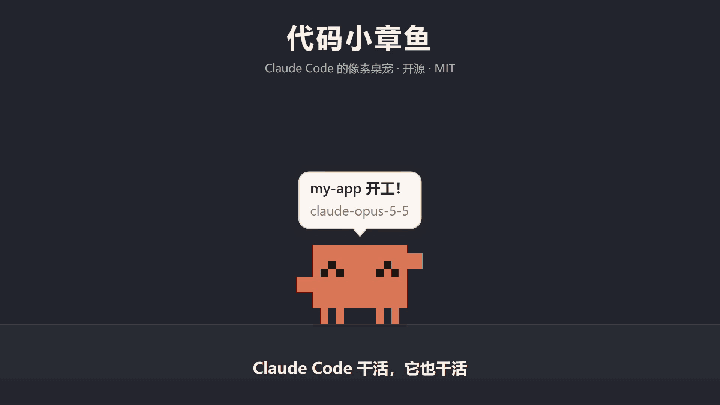

# Code Octopus 代码小章鱼

**简体中文** · [English](README.en.md)

给 Claude Code 用的像素风桌宠（Windows）。



> **非官方项目**：这是一个社区粉丝作品，与 Anthropic 没有任何关联，也没有得到 Anthropic 的认可或背书。Claude 和 Claude Code 是 Anthropic 的商标。

一只像素风的小章鱼，住在你的桌面上，和 Claude Code 联动：

- **Claude 干活，它也干活**：思考时头顶冒点点，改代码时抱着笔记本敲键盘，跑命令时旁边弹出小终端，翻代码时拿放大镜，上网查资料时头上竖起天线
- **需要你做决定时它来找你**：权限请求、Claude 用提问工具问你问题、计划写好等你确认时，它举着闪烁的「!」/「?」牌子一路蹦着跑到屏幕中间，到了以后一直在那跳，气泡发光并写着要你批准的命令或要回答的问题；点它一下表示"知道了"
- **Claude 风格的气泡和字幕**：米白圆角气泡；干活时像 Claude Code 的状态行一样有转圈的 ✻ 和计时，标题是当前待办；字幕会逐字打出你发的消息、正在跑的命令、Claude 做完后的总结。设置里分「只提醒 / 简洁 / 详细」三档
- **会庆祝也会难过**：测试通过、任务完成时撒彩纸，测试挂了会掉眼泪；Claude 提交代码时它握拳、身边冒出一个绿色的勾，推送成功时挥手放一枚小火箭（只认真的成功了的 `git commit` / `git push`，没东西可提交、推送被拒都不算）
- **子代理 = 小助手**：Claude 派出子代理时，旁边会蹦出几只迷你小章鱼一起敲键盘
- **多会话 = 多只**：同时开几个 Claude Code 会话就有几只不同颜色的小章鱼，鼠标悬停能看到是哪个项目
- **在桌宠身上直接批准**（设置里打开）：Claude 要权限、而你没在看那个会话的窗口时，牌子下面的气泡里有完整命令和「允许 / 拒绝 / 去终端看看」，点了就把决定回给 Claude Code。按钮出现后要停稳一下（0.7 秒）才能点，免得它蹦到你正要点的地方被误点；命令太长、气泡里显示不全时没有「允许」，要去终端看完整的。你切回那个窗口、在终端里已经处理了、找不到会话所在的窗口、或者 3 分钟没点，就照常在终端里问你
- **进度卡片**：点一下正在干活（或刚干完）的小章鱼，弹出这一轮的待办清单（✓ 做完、▸ 在做、○ 没做）、工具调用次数、改过的文件和最近一条命令
- **点它跳回会话**：它举牌子叫你时点一下，就把那个会话所在的终端 / 编辑器 / Claude 应用窗口切到最前面；右键菜单和设置面板里也有"前往"。原理是按 hook 请求的连接查出发请求的进程，再顺着父进程找到有窗口的那个
- **上下文饱腹度**：从会话的对话记录里读上下文占用，用到一半开始发福、八成撑得圆滚滚（还会走得慢、提醒你 /compact），压缩后瘦回来
- **长任务完成提醒**：一轮跑了 2 分钟以上才做完，而你正看着别的窗口，它会举着绿色的 ✓ 蹦到屏幕中间，气泡写着用时和 Claude 的总结，可选 8-bit 提示音
- **每日小结**：本地记录每天陪 Claude 干了多少活（消息、工具调用、测试、改过的文件、忙碌时长、花费、每小时节奏，以及当天提交了什么、推送了几次），每晚 21:30 举着日报来找你，生成一张可以复制 / 保存的像素风日报卡片；卡片下面是最近 30 天的趋势（忙碌时长 / 工具调用 / 花费，合计、干活的天数、平均、最多的一天），点哪根柱子就看哪天的日报
- **把窗口当地形**：它会在你窗口的标题栏上散步、先往上跳再翻到别的窗口上；你把它脚下的窗口拖走、最小化，它会掉下来摔个屁股墩
- **窗口碰撞**（设置里可关）：窗口是实心的，走路会撞墙掉头或者翻上去，从下面跳会磕到头，拖着窗口撞它能把它推开；被最大化窗口挡住的窗口不算
- **和你互动**：摸头会眯眼脸红，戳肚子咯咯笑，拉手跟你握手，挠脚心乱蹬；一直戳它会气鼓鼓地走开。按住会被压扁、松手弹飞，双击转圈，用鼠标来回蹭它会害羞，拖起来能扔出去
- **逗猫棒**：右键「陪我玩」，光标下面吊着一根羽毛，小章鱼们追着跑、扑上去拍它，跳累了坐下喘气
- **章鱼游戏厅**：右键或托盘菜单里的「小游戏…」，七个小游戏，每个都有规则说明、倒数、暂停（切到别的窗口自动暂停）和结算，最高分会记下来；破了纪录，桌面上的小章鱼跑来替你庆祝。每个游戏还有一个成就（捉虫打到第 8 轮迭代、窗口跳跳到 300 米、批准还是拒绝连对 20 条、塔防守住 15 波、敲代码到 40 WPM、调用栈叠到 30 层、热修复一局修好 65 个），规则页能看到目标和进度，拿到就送一件装扮，桌面上的小章鱼那个部位空着就直接穿上。规则页还可以选**今日挑战**（按 T）：按日期定好的一局，同一天所有人玩到的都一样（掉什么、窗口怎么摆、出什么题、每波来什么、敲哪几行、叠哪些函数、哪个窗口冒出什么），单独记你今天的最好成绩，也算进总的最高分；菜单右上角显示连续玩了几天（今天还没玩会提醒一句），连续 7 天有成就。游戏里的小章鱼就是你的那只，颜色、装扮都一样
  - **捉虫大作战**：Bug 从代码里掉出来，左右跑着接；连着接分数翻倍，Bug 掉到桌上、碰到红色的 `rm -rf` 都扣心，咖啡补心（心满了就加分），每 20 秒进入下一轮迭代，越来越快
  - **窗口跳跳**：踩着一个个小窗口往上跳；蓝色窗口被人拖着走，红色窗口踩一次就最小化，黄色便签是弹簧；从一边出去会从另一边回来，越往上天色从白天变成星空
  - **批准还是拒绝**：Claude 一条条请你批准命令，安全的允许、危险的（`rm -rf ~`、`curl … | sh`、把密钥发出去、强推 main……）拒绝，越来越快，错三次结束，结算时告诉你每条错在哪。题库里的命令只是拿来显示的文字，不会执行
  - **守护主分支**（塔防）：Bug 顺着一条 git 分支线爬向 `main`，路边放小章鱼当防御塔——测试（单体、快）、Lint（黏住减速，溅到旁边的也一起慢）、代码评审（范围伤害）、类型检查（射程远、伤害高、慢），都能升到 3 级、也能卖掉；敌人有普通 Bug、跑得快的竞态条件、耐打的内存泄漏，每 5 波来一次祖传代码。修 Bug 赚 Token，`main` 的稳定度扣完就结束，波数没有上限；波与波之间可以提前开打（多拿 Token），能切 2 倍速
  - **敲代码**：60 秒里照着屏幕上的代码一行一行地敲（`git status`、`const sum = a + b;`、SQL……），敲对的字变绿，敲错了停在原地，要敲对才往前走；整行一个没错多加 10 分，越往后行越长，结算看 WPM 和准确率。要用英文输入法，开着中文输入法时会提醒你切
  - **调用栈**：一键游戏。新的栈帧（`fetchUser()`、`db.query()`……）在上面左右滑，按空格或点一下落下，没对齐的部分被切掉，栈帧越来越窄；正好对齐不切，连着对齐还会变宽一点，一点都没叠上就结束。越往上滑得越快，左边像调试器一样列出当前的调用栈；叠到 40 层以后全是 `recurse()`，到 50 层就是 Stack Overflow
  - **热修复**：用鼠标玩。九个终端窗口里不停冒出 Bug，点一下（或按数字键 1-9）就修好了，连着修越多分越高；红色的线上事故分高，但让它溜走要扣心；绿色的新功能别点，点了也扣心。60 秒或者三颗心扣完结束
- **番茄钟和便签**：右键开始番茄钟（15 / 25 / 45 分钟），专注时它抱着笔记本陪你敲键盘，到点举着番茄牌子叫你休息；「记一下」写一句话，可以定时提醒，到点它举着便签跑来
- **放歌它就跳舞**：电脑在放声音时，闲着的跟着节拍蹦，在干活的跟着点头（只读系统播放音量的大小，不录音）
- **跟着时间变化**：早上问好、中午提醒吃饭、夜里提着小灯笼，后半夜还在用电脑会劝你早点睡
- **自己找乐子**：闲着时散步、坐下、伸懒腰、东张西望、跳舞；两只碰面会打招呼；困了先打哈欠再睡
- **小章鱼们一起玩**：两只以上闲着、站在同一段平台上时，隔一会儿会抛球、叠罗汉或者排队走；只有一只时，右键「叫小伙伴来玩」会叫一只打扮不一样的来陪它玩一局，玩完就走
- **成就和装扮**：21 个成就（第一次测试通过、连续 7 天、一天 500 次工具调用、凌晨还在干活、累计提交 100 次……，以及章鱼游戏厅里每个游戏一个、今日挑战连续 7 天一个），每个解锁一件装扮（皇冠、礼帽、墨镜、领结、围巾、领带……；游戏里能拿到 Bug 发卡、飞行护目镜、安全徽章、安全帽、绿色遮光帽、单片眼镜、金牌、消防头盔），那个部位空着就自动穿上，在设置的「衣柜」里换；按电脑上的日期自动换节日装扮（新年、春节、情人节、愚人节、儿童节、端午、中秋、1024 程序员节、万圣节、圣诞节），头上空着时还会戴应季的小东西（春花、夏草帽、秋枫叶、冬耳罩），偶尔飘下花瓣、萤火虫、落叶、雪花
- **喂文件**：从资源管理器把文件拖到它身上，它张嘴吃掉，挪进「章鱼的肚子」文件夹按月份放好。只挪不删，右键「吐出来」能放回原处；文件夹和系统目录里的文件不吃。下载文件夹堆了 25 个以上文件时，它一天最多来喊一次饿
- **多显示器**：每块屏一个覆盖层，桌宠会走到、被扔到、被拖到隔壁屏上；新会话的小章鱼出现在会话窗口所在的那块屏；「叫到屏幕中间」叫到你正看着的那块屏
- **新手引导**：第一次打开时小章鱼从屏幕中间掉下来，自我介绍、演示几样本事，最后带你去接入 Claude Code（设置面板里可以再看一遍）
- **多语言**：自动跟随系统语言，支持简体中文、繁體中文、English、日本語，也可以在设置里手动切换
- 你离开电脑 5 分钟它们会睡着，回来时挥手欢迎；全屏看视频、玩游戏时自动躲起来，这时 Claude 要你批准、有问题问你、计划写好了或者长任务做完了，改成弹一条系统通知，点它回到那个会话（设置里可关）；开着「在桌宠上批准」时，被全屏挡住的权限请求直接交给终端

## 安装

到 GitHub 的 Releases 页面下载 `Code-Octopus-Setup-<版本>.exe` 安装。安装包没有代码签名，Windows 第一次运行会弹出「Windows 已保护你的电脑」：点「更多信息」→「仍要运行」。装好后在托盘图标的设置里点「接入 Claude Code」。

## 从源码运行

```bash
npm install
npm start
```

或者直接双击 `启动桌宠.cmd`。

> 如果 `npm install` 之后启动报找不到 Electron，执行一次 `node node_modules/electron/install.js`（新版 npm 默认不运行安装脚本）。

### 打包成安装包

```bash
npm run dist
```

在 `dist/` 里生成 `Code-Octopus-Setup-<版本>.exe`（NSIS 安装包，可以选安装目录，装在当前用户下，不需要管理员权限）；`npm run pack` 只生成免安装的 `dist/win-unpacked/`。图标由 `scripts/make-icon.js` 从托盘图标的像素点阵生成。安装包没有代码签名，别人第一次运行会看到 SmartScreen 的"未知发布者"提示。

安装版和开发版用同一个数据目录（`%APPDATA%\claude-pet`，改名前就叫这个，没改是为了老用户的设置和统计不丢），设置、统计、成就都通用；单实例锁也是同一个，不会同时开两个。

**自动更新**：安装版会从 GitHub Releases 检查新版本、后台下载、退出时安装。发布到哪个仓库写在 `src/release.json`；现在是 `xiaobai1556/code-octopus`（如果还是占位符 `YOUR_GITHUB_NAME`，打出来的包不会去检查更新）。发新版本：

1. 改 `package.json` 里的 `version`（比如改成 `0.4.0`），提交并推送
2. 推一个同名的标签，GitHub Actions 的「Release」工作流会在 Windows 上跑测试、打包，把安装包和 `latest.yml` 传到 Releases 的一份草稿里（标签和版本号对不上会直接失败）：

   ```bash
   git tag v0.4.0
   ```

   ```bash
   git push origin v0.4.0
   ```

3. 到 GitHub 的 Releases 页面打开那份草稿，写几句更新内容，点「Publish release」。草稿对自动更新不可见，发布之后装了旧版的人才会收到

只想试试打包有没有问题：在 Actions 页面选「Release」→「Run workflow」，它只打包，安装包在那次运行的 Artifacts 里，不碰 Releases。在自己电脑上也可以用 `electron-builder --config electron-builder.config.js --win --publish always`（需要 `GH_TOKEN`）手动发。

启动后右下角托盘里会有小章鱼图标：**左键**打开设置面板，**右键**弹出快捷菜单。桌宠已经在运行时，`npm run settings` 也会打开设置面板，`npm run arcade` 打开章鱼游戏厅。

## 接入 Claude Code

两种方式任选，都在设置面板的「接入 Claude Code」里一键开关；同时开着也没关系，重复的事件会自动去掉。改动对**新开的** Claude Code 会话生效。

**Claude Code 插件（推荐）**：用 Claude Code 自己的插件系统管理，可以随时用 `/plugin` 停用或卸载。设置面板里点「安装」，等价于：

```bash
claude plugin marketplace add <本项目所在目录，或 GitHub 上的 用户名/code-octopus>
```

```bash
claude plugin install code-octopus@code-octopus
```

**直接写入 settings.json**：不依赖插件系统，在 `~/.claude/settings.json` 里加一组 hooks（改之前备份成 `settings.json.bak-claude-pet`），断开时只删桌宠自己加的部分。

两种方式发出的 hook 完全一样：用 curl 把 Claude Code 的事件 POST 到 `http://127.0.0.1:23333/event`，并且是异步的（`async: true`），不会拖慢 Claude；桌宠没开的时候 curl 连不上，也只是静默失败。

只有权限请求（`PermissionRequest`）不一样：它是同步的 `http` hook，打到 `/permission`。异步 hook 返回的决定会被 Claude Code 忽略，所以"在桌宠上批准"只能这样做。没开这个功能时桌宠马上回空响应；桌宠没开时连不上，Claude Code 都照常在终端里问你。从旧版升级上来的，设置面板会提示"更新"：插件点「更新」（插件版本 0.3.0；0.3.0 起插件改名 `code-octopus`，装着旧的 `claude-pet` 插件的点一次「更新」会自动换成新的），settings.json 点「更新」重新接入一次。插件里的 `plugin/hooks/hooks.json` 由 `npm run build:plugin` 从 `src/hooks.js` 生成。

## 卸载

先在设置面板的「接入 Claude Code」里把插件卸掉、settings.json 断开，再到 Windows 的「设置 → 应用」里卸载。卸载程序不会动 `~/.claude`：不先断开的话，之后 Claude Code 每个事件都会白跑一次 curl（连不上，不影响 Claude Code 使用，只是多余）。

已经先卸载了的话，手动清理插件：

```bash
claude plugin uninstall code-octopus@code-octopus --scope user
```

```bash
claude plugin marketplace remove code-octopus
```

再打开 `~/.claude/settings.json`，删掉 `hooks` 里所有带 `claude-pet` 的项。旁边的 `settings.json.bak-claude-pet` 是最后一次接入或断开之前的样子，之后你自己改过的设置不在里面，别直接拿它覆盖。设置、统计、成就存在 `%APPDATA%\claude-pet`，不要了可以整个删掉。

## 设置面板

- **小章鱼们**：每只对应哪个项目、正在干什么、上下文用了多少，可以跳回它的会话、让它睡觉或叫醒
- **互动**：放歌时跳舞、跟着时间变化、免打扰时段（比如 22:00 到 8:00：这段时间里只在要你批准、回答问题时来找你，不说闲话、不响提示音，也不来送日报；时段一过自动恢复，不改你的气泡设置）、番茄钟时长、全局快捷键（打开后 Ctrl+Alt+O 在哪儿都能把小章鱼叫到你正看着的屏幕中间，Ctrl+Alt+G 打开章鱼游戏厅；被别的程序占了会提示）
- **外观**：大小、主色、气泡字幕（只提醒 / 简洁 / 详细）、窗口碰撞、上下文窗口（自动 / 20 万 / 100 万）、提示音、全屏时用系统通知、语言
- **衣柜**：头上、脸上、脖子上各穿一件，没解锁的会显示解锁条件；节日那一排能看到今年每个节日穿什么；节日装扮开关
- **成就**：21 个成就的进度和解锁日期
- **喂文件**：开关、「肚子」放在哪、下载文件夹太乱时提醒、吐出上次吃的
- **更新**：自动更新开关、检查更新（开发版和没配置发布地址时不检查）
- **今日小结**：打开日报卡片，可以翻看前几天
- **小游戏**：打开章鱼游戏厅
- **接入 Claude Code**：上面两种方式的状态和开关（有新版本时可以一键更新），以及「在桌宠上直接批准」
- **最近事件**：最近收到的 Claude Code 事件，以及是从插件还是 settings.json 发来的，方便排查有没有接上
- 演示一遍所有动作、把它们叫到屏幕中间、再看一遍新手引导、开机自启、退出

## 多语言

所有界面文字和小章鱼的台词都在 `src/i18n.js`。默认按系统语言选择（`app.getPreferredSystemLanguages()`），不支持的语言回落到英文。想加一门语言：在 `NAMES` 和 `STRINGS` 里各加一项，再在 `detect()` 里加上对应的系统语言前缀。

## 调试

- `npm test`：跑 `test/` 里的单元测试（Node 自带的 `node:test`，不需要装别的，也不用启动 Electron）。覆盖事件解析和测试结果识别、hooks 的接入和移除、地形、节日和装扮、每日统计、上下文读取、喂文件、多语言文案是否齐全，插件的 `hooks.json` 有没有和 `src/hooks.js` 同步，以及每个小游戏：在 node 里用假画笔让机器人什么都不按、乱按乱点乱敲各玩几局，不能出错、画的坐标不能是 NaN、结算的数字要正常，今日挑战同一天怎么玩出的东西都一样
- `npm run demo`：启动后自动演示一遍所有反应
- `curl http://127.0.0.1:23333/state`：查看每块屏（`screens`：工作区、缩放、通往隔壁屏的口子、点击范围、地形）、每只桌宠的状态和气泡（在哪块屏、穿什么）、每个会话对应的窗口和上下文占用（`sessions`）、已解锁的成就、更新状态、最近收到的事件、被去掉的重复事件数、鼠标按键记录（`captureLog`），最近几次拖窗口时的跟随统计（`drags` 是主进程扫描间隔，`screens[].renderer.stats.rides` 是桌宠收到位置和重画的间隔），以及出过的错：`errors` 是主进程的（定时循环、覆盖层崩溃，崩了的覆盖层会自动重新加载），`screens[].renderer.stats.frameErrors` / `lastFrameError` 是覆盖层主循环的（出错的那一帧跳过，动画接着跑）
- 环境变量 `CLAUDE_PET_SPLIT=1`：把主屏假装成左右两块屏，没有第二块显示器也能试桌宠在屏幕之间转移
- 端口被占用时可以用环境变量 `CLAUDE_PET_PORT` 换一个。只对 settings.json 方式有效（换完要重新接入一次），插件固定用 23333

## 几个踩过的坑

- **不要用 `setIgnoreMouseEvents(true, { forward: true })`**：它会在主进程装全局底层鼠标钩子，高回报率鼠标下会把主进程的定时器饿死，拖窗口时桌宠一顿一顿的。现在改为主进程每 16ms 读一次光标位置。
- **不要订阅 `EVENT_OBJECT_LOCATIONCHANGE`**：鼠标指针每动一下也会触发。现在只订阅"开始 / 结束拖窗口"，拖动期间开 1ms 系统定时器、每 4ms 扫一次窗口位置。
- **高刷屏上 `requestAnimationFrame` 是 144/240Hz**：透明窗口每画一帧都要整屏提交，所以只在画面真的变了才重画。
- **伸出屏幕边的窗口**：撞到这种窗口时"被挡回去"可能把桌宠推到屏幕外面。所以碰撞处理完以后要再看一次屏幕边：隔壁有屏就交过去，没有就拉回来。
- **拖文件喂它时用"复制"效果**：拖放回给资源管理器的效果如果是"移动"，资源管理器可能会自己去删原文件；挪文件由主进程自己做。

## 结构

| 文件 | 作用 |
| --- | --- |
| `main.js` | Electron 主进程：每块屏一个透明置顶的覆盖层、桌宠在屏之间转移、托盘、设置面板、接收 hooks 的本地 HTTP 服务、扫描窗口位置、成就、喂文件 |
| `src/win32.js` | 用 koffi 调 Win32 API：枚举可见窗口、监听拖窗口、调系统定时器精度 |
| `src/terrain.js` | 把窗口上边缘变成可以站的平台（扣掉被前面窗口挡住的部分） |
| `src/events.js` | 把 hook 原始输入压缩成桌宠事件（工具类型、文件名、测试结果等） |
| `src/hooks.js` | 安装 / 移除 `settings.json` 里的 hooks |
| `src/plugin.js` | 通过 `claude plugin` 命令安装 / 卸载桌宠插件 |
| `src/i18n.js` | 多语言文字和系统语言检测 |
| `src/procs.js` | 按 TCP 连接查进程、顺着父进程找会话窗口、把窗口切到前台 |
| `src/context.js` | 从对话记录末尾读上下文占用和累计花费 |
| `src/stats.js` | 每日统计和累计数字（存在 `%APPDATA%\claude-pet\stats.json`） |
| `src/rng.js` | 可以播种的随机数，今日挑战用它让同一天大家玩同一局 |
| `src/notify.js` | 全屏时（小章鱼躲起来）哪些事要弹系统通知、写什么 |
| `src/jsonfile.js` | 存设置、统计、便签、喂文件记录：先写临时文件再改名，写到一半崩溃也不会把文件写坏 |
| `src/achievements.js` | 成就的条件和奖励 |
| `src/outfits.js` | 装扮列表、节日日期（主进程、覆盖层、设置面板共用） |
| `src/feed.js` | 喂文件：挪进"肚子"、记录、吐出来 |
| `src/updater.js`、`src/release.json`、`electron-builder.config.js` | 自动更新和打包配置 |
| `renderer/report.*`、`report-preload.js` | 每日小结卡片 |
| `.claude-plugin/marketplace.json`、`plugin/` | Claude Code 插件市场和插件本体 |
| `renderer/sprite.js` | 程序化绘制像素小章鱼和所有道具，没有任何图片素材 |
| `renderer/pet.js` | 单只桌宠：物理、自由活动、对事件的反应、姿势 |
| `renderer/world.js` | 主循环、鼠标交互、拖文件、会话和桌宠的对应、转移到别的屏、粒子和气泡 |
| `renderer/games.js` | 小章鱼们一起玩：抛球、叠罗汉、排队走、叫小伙伴 |
| `renderer/teaser.js` | 逗猫棒 |
| `renderer/note.*`、`note-preload.js` | 写便签的小窗口 |
| `src/audio.js` | 用 koffi 调 Core Audio 读系统播放音量的峰值（放歌跳舞） |
| `renderer/tour.js` | 新手引导 |
| `renderer/arcade.*`、`arcade-preload.js` | 章鱼游戏厅的外壳：画布缩放、键盘鼠标、菜单、规则、倒数、暂停、结算、音效。直接用浏览器打开 `renderer/arcade.html` 也能玩（成绩存在浏览器里） |
| `renderer/arcade-bugs.js`、`arcade-hop.js`、`arcade-approve.js`、`arcade-defense.js`、`arcade-typing.js`、`arcade-stack.js`、`arcade-whack.js` | 七个小游戏，各自用 `ARCADE.register()` 登记 |
| `src/arcade.js`、`src/arcade-cards.js` | 游戏厅的最高分（`%APPDATA%\claude-pet\arcade.json`）；「批准还是拒绝」的题库 |
| `renderer/settings.*`、`settings-preload.js` | 设置面板 |
| `test/` | 单元测试（`npm test`） |

目前只支持 Windows。

## 许可证

[MIT](LICENSE)：可以随便用、改、再发布，保留版权声明就行。
